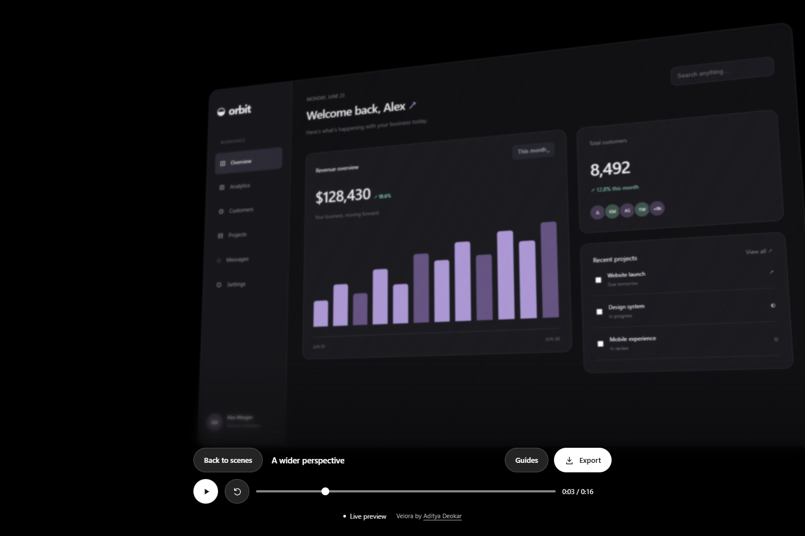
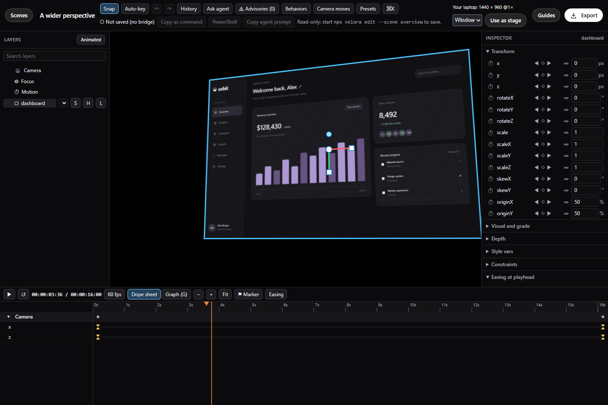

# Velora v2.1 review evidence

## Dashboard preview and Studio

Both screenshots use the checked-in `local-project` demo scene **A wider perspective** (`overview`), paused at 3,600 ms. Chromium 145.0.7632.6 captured both images at 1440 × 960 and DPR 1. The only interaction after opening Studio was selecting the dashboard layer to reveal its controls.

| Before, `master` at `e2ef46e` | After, v2.1 at `ffdd4ad` |
|---|---|
|  |  |

The preview is the playback and export view. Studio fits the same camera frame alongside the inspector and timeline. The Studio screenshot shows the read-only mode available when opened without an edit bridge. The browser tests exercise persistence with a real bridge.

| Image | SHA-256 |
|---|---|
| `dashboard-before.png` | `cae268f8e14072d2ba3d2cc2f4a231f4f9b35fc73d47d51d33c24cf295e80f6d` |
| `dashboard-studio.png` | `8238b2014754492a7d7b816bb320a62a1cd03946d7f573fcdc6a6dc641003278` |

To reproduce the views, prepare the `local-project` demo at each revision with `npm run setup:local`, then run `npm --prefix local-project run dev`. On the base revision, open `/?velora-preview=1&velora-scene=overview`. On v2.1, append `&velora-edit=1` and select the dashboard layer. In either view, seek with `await window.__VELORA_CAPTURE__.seek(3600)`.

## Results by workflow

| Workflow | Evidence |
|---|---|
| Scene authoring | [Byte-exact undo through the bridge](../phase-04-exit.md) and [timeline and graph checks](../phase-05-exit.md) |
| Live source and Three.js | [Reviewed source edits](../phase-08-exit.md) and [repeatable GLB capture and installed React compatibility](../phase-09-exit.md) |
| Composition cutting | [30-second recut, waveform, beat snapping and preview/export comparison](../phase-10-exit.md) |
| Capture and optics | [Laptop viewport and DPR](../phase-12-exit.md), [depth and lighting](../phase-13-exit.md), [lens and focus](../phase-14-exit.md), and [live element locking](../phase-15-exit.md) |
| Physical camera rigs | [Matching frame hashes, clearance and measured telephoto parallax](../phase-16-exit.md) |
| Performance and release qualification | [Hardware timings and remaining release gates](../phase-11-exit.md) |
